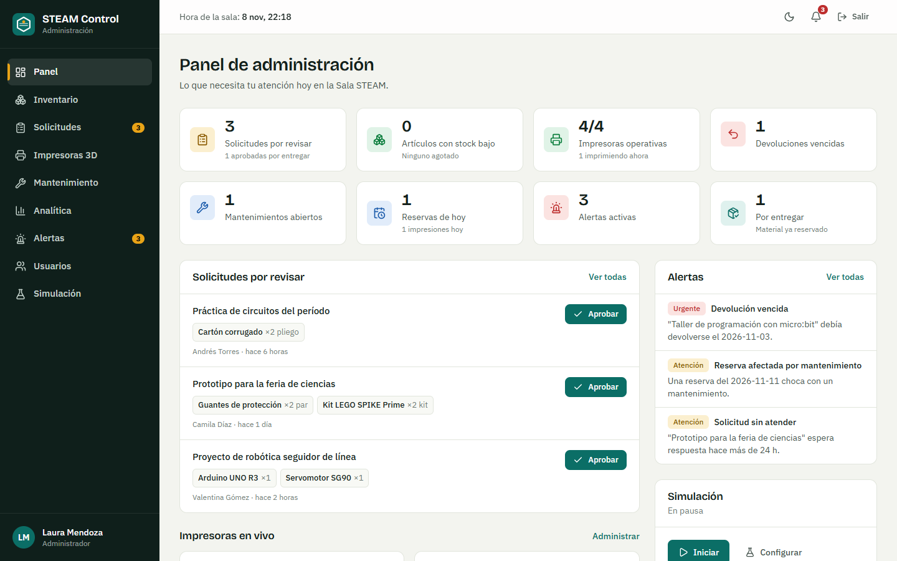
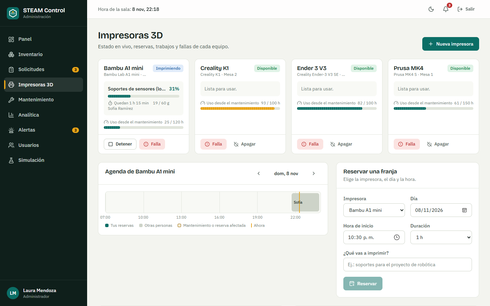
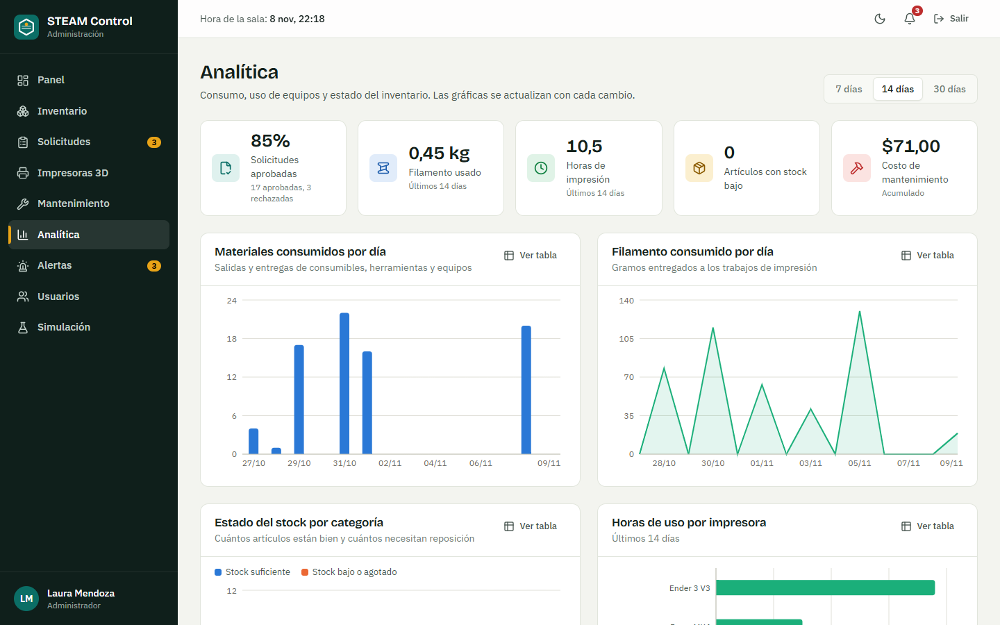
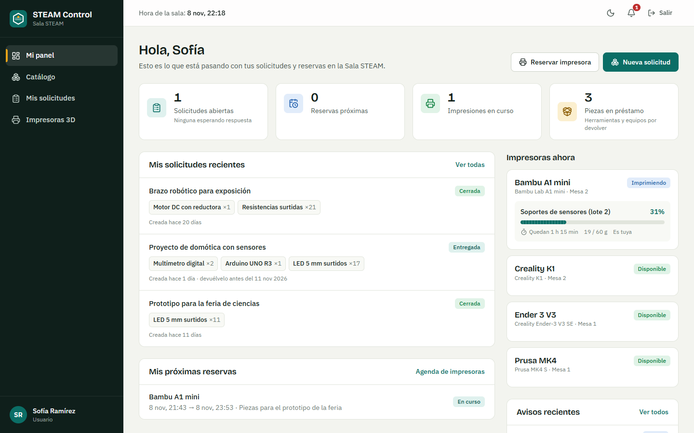
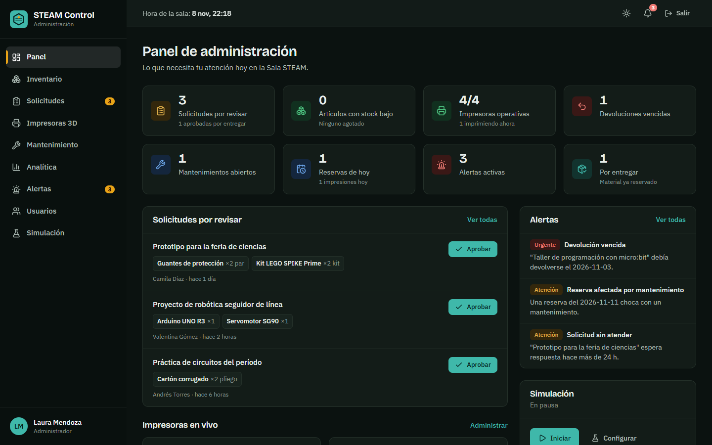

# STEAM Control

Plataforma inteligente de gestión, inventario, solicitudes y mantenimiento para una Sala STEAM.

Una sola aplicación web para que la coordinación de una Sala STEAM controle el material, atienda las solicitudes de docentes y estudiantes, reserve las impresoras 3D y planifique su mantenimiento, con un **simulador** que acelera el tiempo para ver cómo reacciona todo el sistema.

**Demo en línea: <https://steam-control.vercel.app>** (usa las [credenciales de demostración](#credenciales-de-demostración)).



## Qué puedes hacer

| Para… | Qué ofrece |
|---|---|
| **Usuarios** (docentes y estudiantes) | Explorar el catálogo y armar solicitudes de material · seguir su estado hasta la devolución · reservar una franja en una impresora 3D, iniciar su impresión y ver el avance · recibir notificaciones |
| **Administración** | Panel con indicadores y alertas · inventario con libro de movimientos · aprobar (reserva el stock), entregar y recibir devoluciones · gestionar impresoras, reservas y fallas · programar y ejecutar mantenimientos con repuestos y costos · analítica con gráficas · usuarios y roles · simulación |

### Módulos

- **Inventario**: artículos, categorías, entradas, ajustes por conteo y un **libro de movimientos** que explica cada cambio de stock. Alertas de stock bajo y agotado.
- **Solicitudes**: flujo `pendiente → aprobada → entregada → cerrada` (también rechazada y cancelada). Aprobar **reserva** el stock; entregar lo saca del almacén; las herramientas se devuelven.
- **Impresoras 3D y reservas**: agenda por día, detección de conflictos, trabajos que consumen filamento del inventario con el avance real del reloj y fallas que se pueden reportar.
- **Mantenimiento**: preventivo (manual o automático por horas de uso) y correctivo (automático al fallar una impresora). Bloquea la impresora, marca como *afectadas* las reservas que chocan y descuenta los repuestos del inventario.
- **Notificaciones y alertas**: cada evento importante avisa a quien corresponde; las alertas se calculan desde los datos, así que desaparecen solas cuando el problema se resuelve.
- **Analítica**: consumo por día, estado del stock por categoría, uso de impresoras, embudo de solicitudes, costos de mantenimiento. Cada gráfica se puede ver como tabla.
- **Simulación**: acelera el reloj (×10, ×60, ×300) y deja que lleguen solicitudes, se imprima, fallen las máquinas y se repongan materiales, con escenarios (jornada normal, semana de proyectos, equipos con problemas, escasez).

## Capturas

| Impresoras 3D | Analítica |
|---|---|
|  |  |
| **Panel del usuario** | **Modo oscuro** |
|  |  |

## Tecnologías

React 19 · TypeScript (modo estricto) · Vite · Tailwind CSS 4 · React Router · **Dexie (IndexedDB)** · Zod · Zustand · Recharts · date-fns · Vitest · Playwright · oxlint · Prettier.

## Instalación y ejecución

Necesitas [Node.js](https://nodejs.org) 20 o superior.

```bash
git clone https://github.com/JD202730/steam-control.git
cd steam-control
npm install
npm run dev
```

Abre <http://localhost:5173>. La primera vez la app genera los datos de demostración (tarda unos segundos).

Para compilar y servir la versión de producción:

```bash
npm run build
npm run preview
```

## Credenciales de demostración

Son datos **ficticios** y públicos; no corresponden a ninguna cuenta real.

| Rol | Correo | Contraseña |
|---|---|---|
| Administración | `admin@steam.demo` | `Admin2026!` |
| Usuario | `usuario@steam.demo` | `Usuario2026!` |

Hay otros usuarios de ejemplo (`andres@`, `valentina@`, `mateo@`, `camila@steam.demo`, con la contraseña `Usuario2026!`) y una cuenta desactivada (`exalumno@steam.demo`) para probar ese caso. La pantalla de acceso permite rellenar el formulario con un clic.

## Scripts

| Comando | Qué hace |
|---|---|
| `npm run dev` | Servidor de desarrollo |
| `npm run build` | Comprueba tipos y compila para producción |
| `npm run preview` | Sirve la compilación de producción |
| `npm run typecheck` | Solo comprobación de tipos |
| `npm run lint` | Análisis estático (oxlint) |
| `npm test` | Pruebas unitarias y de integración (Vitest) |
| `npm run e2e` | Pruebas de extremo a extremo en un navegador real (Playwright) |
| `node scripts/screenshots.mjs` | Regenera las capturas de `docs/img` |

Las pruebas E2E usan Microsoft Edge en local; en un entorno sin Edge ejecuta antes `npx playwright install chromium` y define `CI=1`.

## Cómo está construida

Es una aplicación 100 % de navegador, pensada como **simulador**: los datos viven en IndexedDB y no hay servidor.

```
src/
├── app/            arranque, rutas, layout y proceso en segundo plano
├── core/           base de datos, reloj, eventos, permisos, autenticación
├── modules/        inventory · requests · printers · maintenance ·
│                   notifications · analytics · simulation · users
├── pages/          pantallas (auth, user, admin, shared)
├── shared/         componentes de interfaz, gráficas, formatos y hooks
└── seed/           datos de demostración
```

Ideas clave (detalle en [docs/ARQUITECTURA.md](docs/ARQUITECTURA.md) y [docs/MODELO_DATOS.md](docs/MODELO_DATOS.md)):

- **Coherencia por construcción**: el stock solo cambia mediante un único punto de entrada que escribe el movimiento y actualiza el artículo en la misma transacción. `verifyLedger()` recalcula el inventario desde el libro y comprueba que cuadra; las pruebas lo usan después de cada flujo y de cientos de pasos de simulación.
- **Módulos desacoplados** que se hablan por **eventos de dominio** (`request.approved`, `printer.failed`, `stock.low`…), publicados después de confirmar cada transacción.
- **Permisos en tres niveles**: guarda de ruta, componente `<Can>` y comprobación dentro de cada servicio (por eso las pruebas verifican permisos de verdad, no solo botones ocultos).
- **Un reloj propio**: todo el dominio lee la hora de `clock`, lo que permite acelerar el tiempo, generar el historial de demostración "viajando en el tiempo" y hacer pruebas deterministas.
- **La interfaz es reactiva**: se suscribe a la base de datos (`liveQuery`), así que las gráficas, alertas y notificaciones cambian solas, incluso desde otra pestaña.

## Persistencia y límites (importante)

- Los datos se guardan en el **navegador** de cada persona (IndexedDB). Sobreviven a recargar y a cerrar el navegador, pero **no se comparten entre dispositivos ni entre navegadores**. En un despliegue público cada visitante tiene su propia sala de demostración.
- Como todo ocurre en el cliente, los **roles son una simulación**: sirven para demostrar la lógica de permisos, pero no equivalen a la seguridad de un servidor. Las contraseñas se guardan con PBKDF2, nunca en claro, pero alguien con acceso al navegador podría alterar los datos locales.
- Para producción real, la capa de servicios (`modules/*/service.ts`) está diseñada para trasladarse a un backend con una base de datos como Postgres sin reescribir la interfaz.
- Menú **Simulación → Restablecer datos de demostración** borra todo y regenera el historial.

## Despliegue

Es una SPA estática: `vercel.json` ya incluye la configuración para Vercel (build con `npm run build`, salida en `dist` y reescritura de rutas a `index.html`). No requiere variables de entorno ni secretos.

Está publicada en <https://steam-control.vercel.app>. Para volver a desplegar tras un cambio:

```bash
npx vercel deploy --prod
```

(la primera vez pide iniciar sesión en Vercel). Para comprobar el sitio publicado con las pruebas de extremo a extremo:

```bash
E2E_BASE_URL=https://steam-control.vercel.app npm run e2e   # en PowerShell: $env:E2E_BASE_URL="..."; npm run e2e
```

## Pendiente / ideas

- Backend real (autenticación y datos compartidos entre dispositivos).
- Importación y exportación de inventario en CSV.
- Calendario mensual de reservas y recordatorios por correo.
- Integración continua con GitHub Actions (pruebas y compilación en cada commit).
